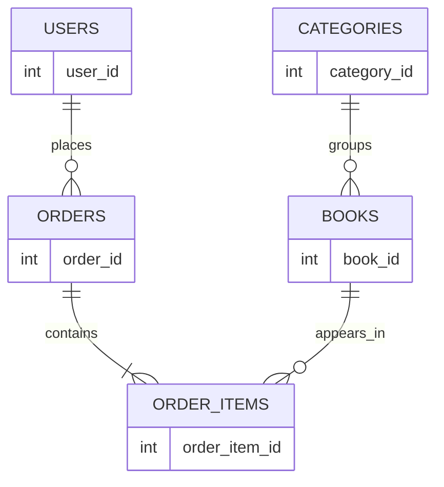

# OnlineBookstore draft ERD

This is the Milestone 1 planning draft. It identifies the entities and their relationships; database columns, keys, and implementation will be refined in Milestone 2.

The five planned entities are Users, Books, Categories, Orders, and OrderItems. A user can place orders; each order contains order items; each order item refers to a book; and a category groups books.
