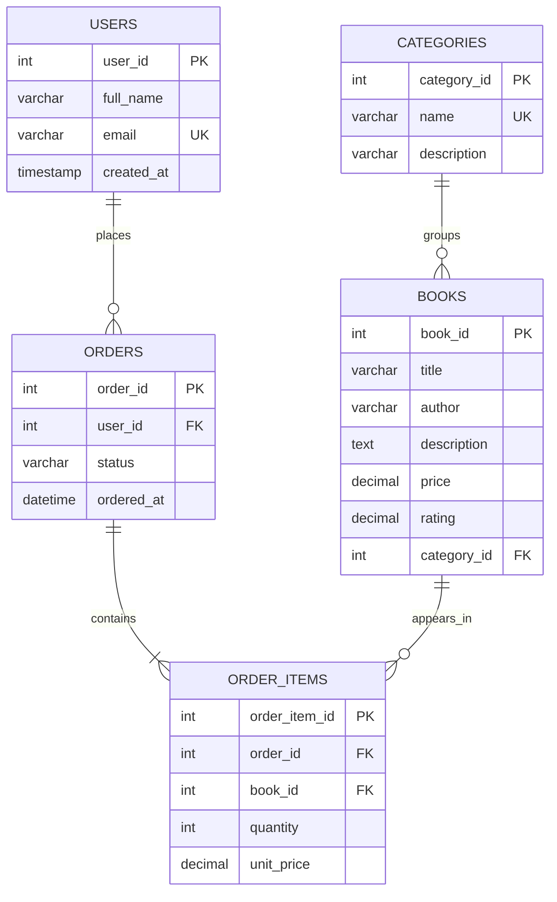

# OnlineBookstore ERD

This schema is implemented in `database/online_bookstore.sql` for Milestone 2.

The five entities are Users, Books, Categories, Orders, and OrderItems. A user may place zero or more orders, and each order belongs to one user. Every placed order contains one or more order items; each item belongs to one order and refers to one book. A book may appear in zero or more order items. A category may group zero or more books, and each book belongs to one category. Foreign keys connect each dependent table to its parent. The `order_items` table stores the purchase price for each book in an order.

The one-or-more rule describes a valid placed order. The foreign key in `order_items` ensures each item belongs to an order, but does not by itself prevent an empty row in `orders`. Order creation must require at least one item.
